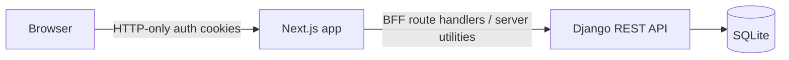

# WorkNest

> **Status: active development.**

WorkNest is a full-stack project-management application for creating projects,
organising tasks, and moving work through a simple task board. It is being
actively built as a portfolio project and a practical exploration of modern
React and Django patterns.

## Highlights

- Project creation, editing, and deletion
- Kanban-style task board with Todo, In Progress, and Done columns
- Task titles, descriptions, priorities, and status updates
- JWT-based sign-in, sign-out, and token refresh flows
- Per-user ownership scoping for projects and tasks
- Server-side data fetching and API route handlers in Next.js
- Reusable TypeScript UI components styled with Tailwind CSS

## Tech stack

| Layer | Technology |
| --- | --- |
| Frontend | Next.js App Router, React, TypeScript, Tailwind CSS |
| Backend | Django, Django REST Framework |
| Authentication | Simple JWT |
| Local database | SQLite |
| Tooling | pnpm, ESLint, Prettier |

## Architecture



The frontend uses a small BFF-style layer: browser interactions go through
Next.js route handlers, while server utilities call the Django API with a JWT
bearer token. This keeps tokens out of client-side JavaScript and gives the
frontend a single, same-origin interface.

### Intentional authentication transition

The current BFF architecture is **intentional**. Next.js currently receives
JWTs from Django, stores them in HTTP-only cookies, refreshes access tokens
server-side, and proxies authenticated operations to the API.

This is an intermediate architecture, not an accidental duplication of auth
responsibilities. The planned direction is for Django to own authentication
cookies directly, so the backend becomes the source of truth for issuing,
refreshing, and clearing auth cookies. The BFF layer will then be simplified
or removed where it no longer provides value.

## Repository layout

```text
.
├── frontend/              # Next.js application
│   └── src/app/api/       # BFF route handlers
└── backend/               # Django and Django REST Framework API
    ├── core/              # Projects and tasks
    └── users/             # User model and auth endpoints
```

## Getting started

### Prerequisites

- Node.js 20+ and pnpm 10+
- Python 3.12+

### 1. Start the Django API

```bash
cd backend
python -m venv .venv
source .venv/bin/activate
pip install -r requirements.txt

export DJANGO_SECRET_KEY="replace-with-a-long-random-secret"
export DEBUG=True

python manage.py migrate
python manage.py createsuperuser
python manage.py runserver
```

The API is available at `http://localhost:8000`.

### 2. Start the Next.js app

In a second terminal:

```bash
cd frontend
pnpm install

printf 'BACKEND_API_URL=http://localhost:8000/api\n' > .env.local
pnpm dev
```

Open [http://localhost:3000](http://localhost:3000), then sign in using the
account created above.

## Useful commands

```bash
# Frontend
cd frontend
pnpm lint
pnpm format:check
pnpm build

# Backend
cd backend
python manage.py check
python manage.py test
```

## API overview

| Endpoint | Purpose |
| --- | --- |
| `POST /api/users/token/` | Obtain access and refresh JWTs |
| `POST /api/users/token/refresh/` | Refresh an access JWT |
| `GET /api/users/me/` | Get the current user |
| `/api/projects/` | List and create projects |
| `/api/projects/:projectId/` | Retrieve, update, or delete a project |
| `/api/projects/:projectId/tasks/` | List and create tasks |
| `/api/projects/:projectId/tasks/:taskId/` | Retrieve, update, or delete a task |

All project and task API access is scoped to the authenticated user.

## Screenshots

Screenshots will be added as the interface and core flows stabilise.

## Roadmap

- [ ] Move authentication-cookie ownership to the Django backend
- [ ] Add a production database configuration
- [ ] Add automated backend and frontend tests
- [ ] Improve board interactions and task workflows
- [ ] Add deployment documentation and screenshots

## Before publishing

Do not commit secrets or local runtime data. Keep `.env` files, SQLite
databases, virtual environments, `node_modules`, `.next`, `__pycache__`, and
local media out of version control. Use placeholder values in committed
environment examples instead.
