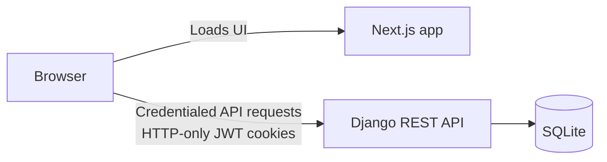

# WorkNest

> **Status: active development.**

WorkNest is a full-stack project-management application for creating projects,
organising tasks, and moving work through a simple task board. It is being
actively built as a portfolio project and a practical exploration of modern
React and Django patterns.

## Highlights

- Project creation, editing, and deletion
- Kanban-style task board with Todo, In Progress, and Done columns
- Task titles, descriptions, priorities, and status updates
- Backend-owned, HTTP-only JWT cookie authentication with sign-in, sign-out,
  and token refresh flows
- Per-user ownership scoping for projects and tasks
- Direct, credentialed browser requests to the Django REST API
- Reusable TypeScript UI components styled with Tailwind CSS

## Tech stack

| Layer | Technology |
| --- | --- |
| Frontend | Next.js App Router, React, TypeScript, Tailwind CSS |
| Backend | Django, Django REST Framework |
| Authentication | Simple JWT |
| Local database | SQLite |
| Tooling | pnpm, ESLint, Prettier |

## Architecture



### Authentication

Django owns the complete authentication-cookie lifecycle. On login it issues
access and refresh JWTs as HTTP-only cookies; protected API requests are
authenticated from the access-token cookie; the refresh endpoint renews the
access token when needed; and logout clears both cookies. The frontend sends
credentialed requests but cannot read the token values from JavaScript.

This replaces the earlier BFF approach. The Next.js application no longer
stores or proxies tokens, leaving the Django API as the single source of truth
for authentication. CORS and trusted-origin settings allow the local Next.js
application to make these credentialed requests during development.

### Backend scope

The API is deliberately lean in product scope while demonstrating core
Django/DRF practices: a custom user model, JWT authentication, permission-
protected endpoints, ownership-scoped querysets, serializers, and migrations.

## Repository layout

```text
.
├── frontend/              # Next.js application and API client
└── backend/               # Django and Django REST Framework API
    ├── core/              # Projects and tasks
    └── users/             # User model and cookie-based auth endpoints
```

## Getting started

### Prerequisites

- Node.js 20+ and pnpm 10+
- Python 3.12+

### 1. Start the Django API

```bash
cd backend
python -m venv .venv
source .venv/bin/activate
pip install -r requirements.txt

export DJANGO_SECRET_KEY="replace-with-a-long-random-secret"
export DEBUG=True

python manage.py migrate
python manage.py createsuperuser
python manage.py runserver
```

The API is available at `http://localhost:8000`.

### 2. Start the Next.js app

In a second terminal:

```bash
cd frontend
pnpm install

printf 'NEXT_PUBLIC_BACKEND_API_URL=http://localhost:8000/api\n' > .env.local
pnpm dev
```

Open [http://localhost:3000](http://localhost:3000), then sign in using the
account created above.

## Useful commands

```bash
# Frontend
cd frontend
pnpm lint
pnpm format:check
pnpm build

# Backend
cd backend
python manage.py check
python manage.py test
```

## API overview

| Endpoint | Purpose |
| --- | --- |
| `POST /api/users/login/` | Sign in and set HTTP-only auth cookies |
| `POST /api/users/logout/` | Clear HTTP-only auth cookies |
| `POST /api/users/token/refresh/` | Refresh the access-token cookie |
| `GET /api/users/me/` | Get the current user |
| `/api/projects/` | List and create projects |
| `/api/projects/:projectId/` | Retrieve, update, or delete a project |
| `/api/projects/:projectId/tasks/` | List and create tasks |
| `/api/projects/:projectId/tasks/:taskId/` | Retrieve, update, or delete a task |

All project and task API access is scoped to the authenticated user.

## Screenshots

Screenshots will be added as the interface and core flows stabilise.

## Roadmap

- [x] Move authentication-cookie ownership to the Django backend
- [ ] Add a production database configuration
- [ ] Add automated backend and frontend tests
- [ ] Improve board interactions and task workflows
- [ ] Add deployment documentation and screenshots

## Before publishing

Do not commit secrets or local runtime data. Keep `.env` files, SQLite
databases, virtual environments, `node_modules`, `.next`, `__pycache__`, and
local media out of version control. Use placeholder values in committed
environment examples instead.
